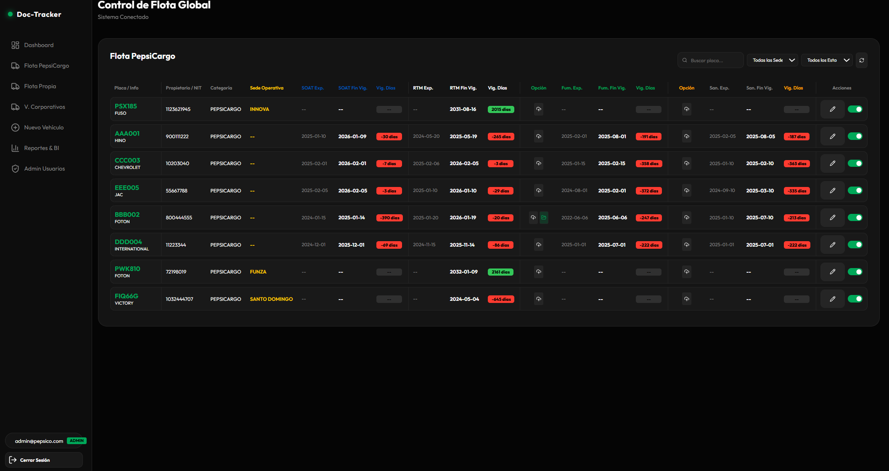
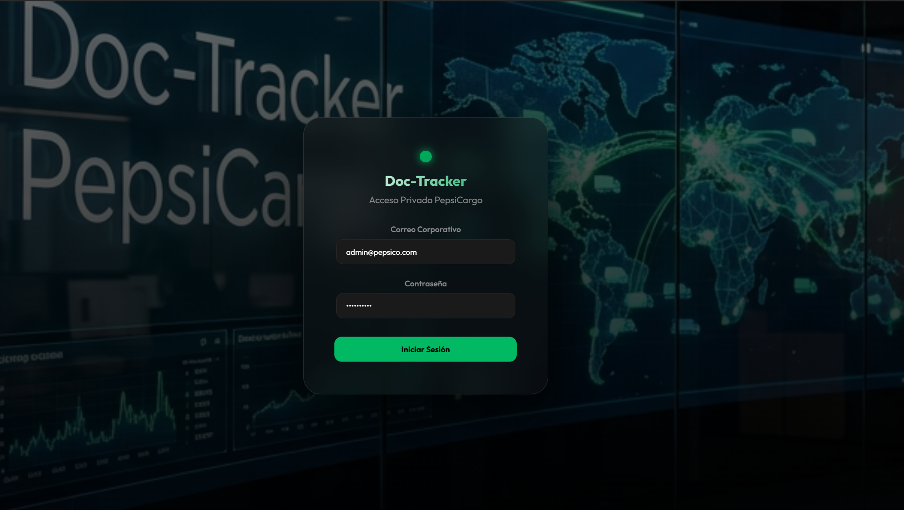
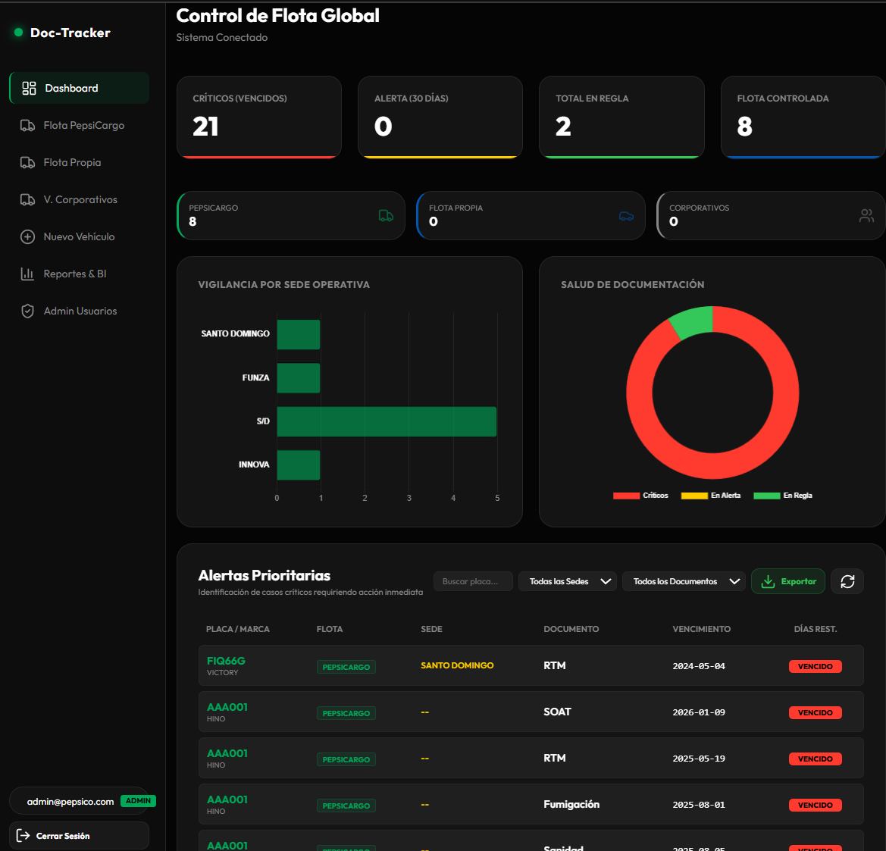
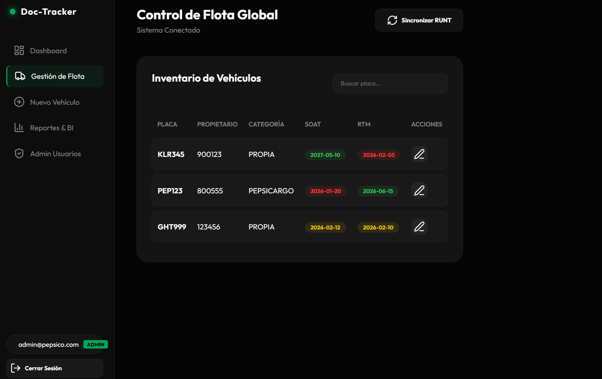
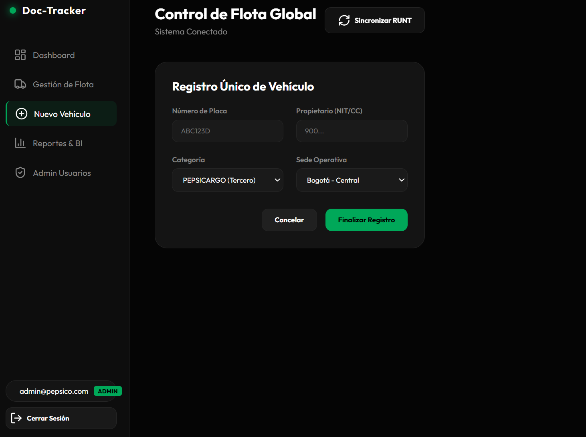
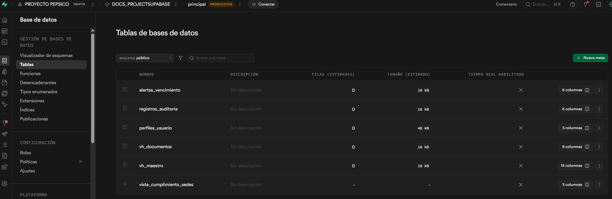
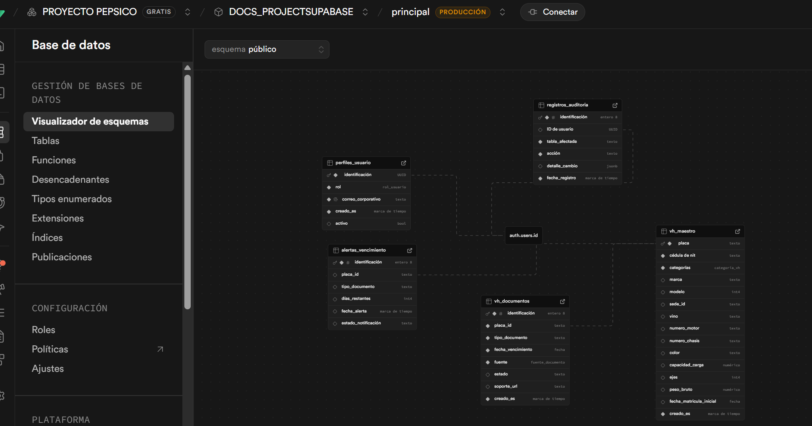

# 🚚 Doc-Tracker Pepsicargo

## 🎯 Objetivo del Proyecto
**Doc-Tracker** es una solución empresarial de vanguardia diseñada para el control riguroso de la documentación de flota en **PepsiCargo**. El sistema automatiza el seguimiento de vigencias críticas (SOAT, RTM, Seguros), integrándose directamente con fuentes oficiales como el **RUNT** para garantizar que ningún vehículo opere fuera de la norma.

## 🚀 Vista de la Aplicación

### � Acceso Seguro y Privado
La aplicación cuenta con una pantalla de inicio de sesión con estética **Glassmorphism**, asegurando que solo personal autorizado de PepsiCargo acceda a la información sensible.

### 📊 Panel de Control (Dashboard)
Visualización inmediata de KPIs críticos. El dashboard categoriza los vehículos según su estado de cumplimiento, destacando aquellos en situación **Crítica**, en **Alerta** o **En Regla**.

### 🚛 Gestión de Flota e Inventario
Una vista tipo "Dataframe" que permite buscar y filtrar vehículos por placa. Muestra de forma inteligente el estado de los documentos fundamentales con códigos de colores accionables.

### 📝 Registro y Control Técnico
Formularios optimizados para el ingreso de nuevas unidades, con campos específicos para flota propia y terceros, incluyendo VIN, motor y capacidad de carga.

---

## 🏗️ Arquitectura y Datos

El proyecto utiliza **Supabase** como núcleo de datos, aprovechando PostgreSQL para la lógica de negocio y seguridad.

### Modelo de Datos
La arquitectura está diseñada para la escalabilidad, incluyendo tablas de auditoría y políticas de seguridad RLS.

### Catálogo de Tablas
Estructura modular que separa la información del vehículo de sus documentos y alertas de vencimiento.

---

## ✨ Bondades del Sistema

1.  **Sincronización RUNT:** Olvida el ingreso manual. El sistema captura datos directamente del ministerio.
2.  **Auditoría de Cambios:** Cada movimiento queda registrado con usuario y timestamp.
3.  **Diseño Adaptativo:** Una interfaz fluida y moderna que funciona en cualquier resolución.
4.  **Notificaciones Inteligentes:** Sistema de alerta temprana para prevenir multas y bloqueos operativos.

## 🛠️ Stack Tecnológico

- **Frontend:** HTML5, Vanilla JavaScript, CSS3 (Modern UI).
- **Backend:** Python Bridge (HTTP Listener).
- **Automation:** Playwright & OCR para interacción con RUNT.
- **Base de Datos:** PostgreSQL (Supabase).

---
**PepsiCargo Doc-Tracker - Eficiencia en Movimiento.**
