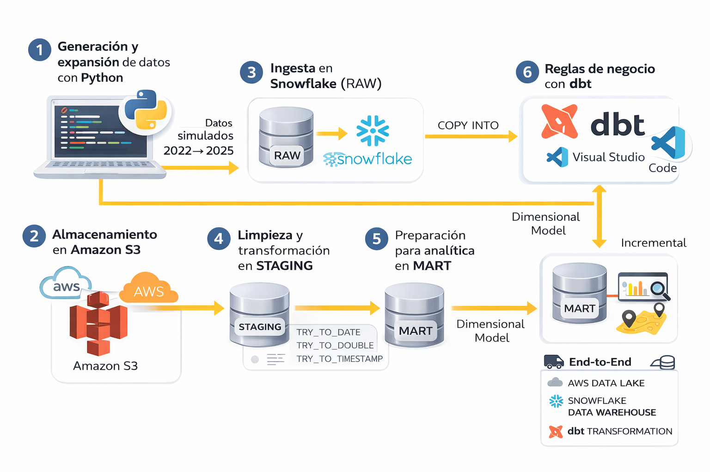
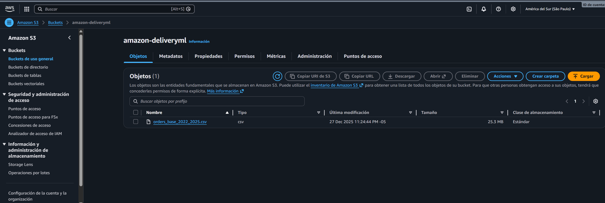
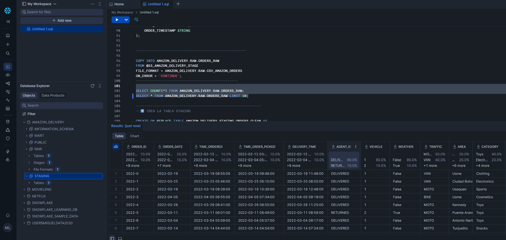
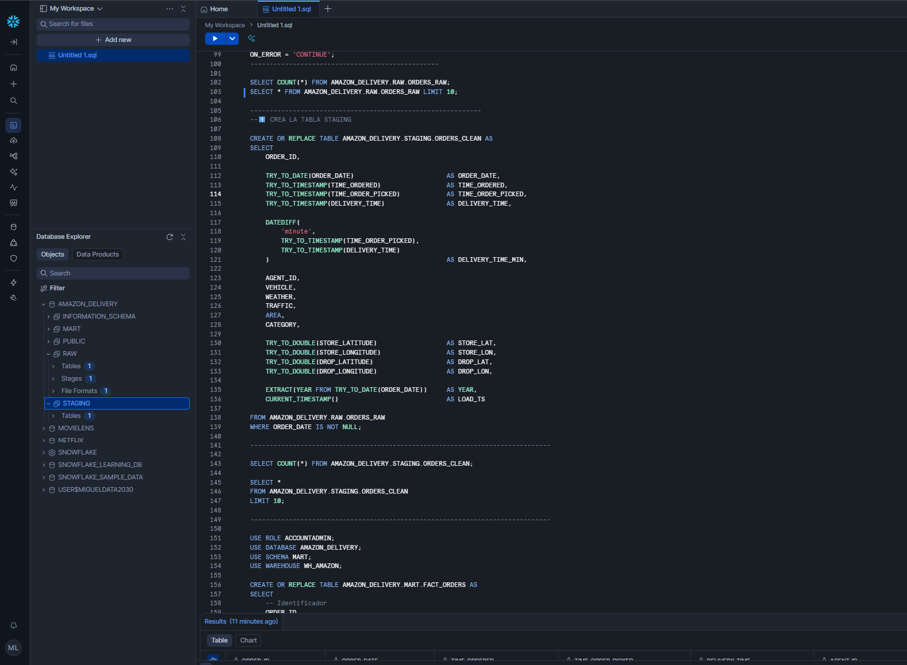
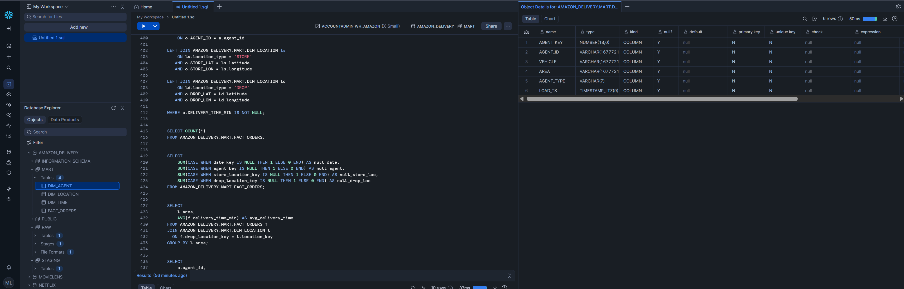

## 🚚 End-to-End Data Engineering Project – Amazon Delivery (Last Mile)

En este proyecto diseñé e implementé una **arquitectura end-to-end de ingeniería de datos**, simulando un escenario real de **logística y entregas de última milla**.  
El objetivo fue transformar datos crudos en información confiable y lista para análisis, aplicando **buenas prácticas de Data Engineering modernas**.
---

## 🎯 Problema de negocio

La mayoria de empresas tienen los siguientes problemas al momento de obtener los datos de ultima milla:

- Archivos de diferentes fuentes SQL, SCV, EXCEL,Bases de datos
- Tener fechas, horas y coordenadas mal tipadas
- Mezclar datos históricos con datos recientes
- No estar listos para análisis ni KPIs operativos
- Una gran base de datos pero no toda es necesaria
- Estructura de que queremos extraer de esa gran cantidad de datos

Esto dificulta responder preguntas clave como:

- ¿Cuánto tarda una entrega?
- ¿Qué repartidores son más eficientes?
- ¿Qué zonas presentan más demoras o devoluciones?
- ¿cada cuanto necesito que mis datos se actualicen?
- ¿Es realmente efectiva mi logistica de ultima milla respondiendo a estos KPIS?

---

## Teniendo encuenta estos problemas planteo la siguiente Solucion Diseñar 
## Una Arquitectura Enterprice Desacoplada y escalable basada en:

- **Amazon S3** como Data Lake 
- **Snowflake** como Data Warehouse 
- Separación clara por capas:
  - **RAW** → datos crudos
  - **STAGING** → limpieza y tipado
  - **MART** → consumo analítico
Esto es algo Sencillo pero cubre esta necesidad!!!
---

## 🏗️ Arquitectura de Datos

**Flujo general:**

1. Generación y expansión de datos con **Python**
2. Almacenamiento en **Amazon S3**
3. Ingesta en **Snowflake (RAW)**
4. Limpieza y transformación en **STAGING**
5. Preparación para analítica en **MART**
6. Reglas de negocio con DBT **VISUAL STUDIO CODE**

---

## 🧪 Generación y preparación de datos (Python)

- Dataset base de entregas
- Expansión temporal de **2022 a 2025**
- Simulación de crecimiento del negocio
- Normalización de columnas
- Exportación final para ingesta

Esto permite simular un entorno real con **volumen creciente y datos históricos**.
Solo tenia datos del 2022 lo que realice fue simular los demas años, 
para poder practicar reglas de negocio para practicar DBT

---

## ☁️ Data Lake – Amazon S3

- Bucket: `amazon-deliveryml`
- Almacenamiento de archivos CSV
- Fuente única de verdad
- Arquitectura desacoplada (storage ≠ compute)

---

## ❄️ Data Warehouse – Snowflake (RAW)

En la capa **RAW**:

- Se crea un **External Stage** apuntando a S3
- Se define un **File Format CSV**
- Se cargan los datos usando `COPY INTO`
- Los datos se almacenan **sin transformaciones**

Esta capa preserva la información original tal como llega.

---

## 🧼 Capa STAGING – Limpieza y tipado

En **STAGING** se aplican transformaciones clave:

- Conversión segura de tipos:
  - `TRY_TO_DATE`
  - `TRY_TO_TIMESTAMP`
  - `TRY_TO_DOUBLE`
- Manejo de valores inconsistentes
- Cálculo de métricas operativas:
  - ⏱️ `DELIVERY_TIME_MIN`
- Normalización de coordenadas geográficas
- Enriquecimiento temporal (YEAR, LOAD_TS)

Aquí los datos quedan **confiables y listos para análisis**.

---

## 📊 Capa MART – Consumo analítico

La capa **MART** queda preparada para:

- Dashboards en Power BI / Tableau
- KPIs operativos
- Análisis de productividad
- Modelos de Machine Learning
- Feature engineering

Ejemplos de uso:
- Tiempo promedio de entrega
- Rendimiento por repartidor
- Zonas con más devoluciones
- Impacto del tráfico y clima

---

## 📊 DBT  – Reglas de Negocio

En esta etapa se implementaron reglas de negocio y modelos analíticos usando dbt,
con el objetivo de transformar los datos limpios en métricas 
confiables y reutilizables para el negocio.

Principales tareas realizadas:

- Definición de modelos analíticos a partir de la capa STAGING
- Cálculo de KPIs operativos (tiempos de entrega, rendimiento por repartidor)
- Estandarización de métricas para consumo en BI y analítica avanzada
- Aplicación de buenas prácticas de transformaciones versionadas y reproducibles

El uso de dbt permitió separar claramente la lógica de negocio del procesamiento técnico, 
facilitando la escalabilidad, el mantenimiento y la trazabilidad de los datos.

## 🧩 Tecnologías utilizadas

- **Python** (Pandas, NumPy)
- **Amazon S3**
- **Snowflake**
  - Stages
  - File Formats
  - COPY INTO
  - SQL transformations
- **Arquitectura Medallón**
- SQL analítico

---

## 🧠 Conclusión

Que Realmente Aprendi de esta implementacion:

- Entender La necesidad de Negocio y que herramientas poder Utilizar
- Me cuestione en algun momento si esto necesariamente deberia utilizar arquitectura Enterprice
- Por que utilice estas Herramientas y no otras
- Convertir datos crudos en información accionable
- Aplicar buenas prácticas modernas de Data Engineering

## 👽 Reflexion:
Al avanzar en la implementación de la solución, confirmé que la ingeniería de datos no empieza con la tecnología,
sino con el entendimiento del negocio. Antes de escribir una sola línea de código, es clave comprender qué preguntas se quieren responder,
con qué nivel de precisión y en qué momento.
Otro aprendizaje importante fue dimensionar de forma realista el volumen de datos que se moverá a lo largo del pipeline, 
ya que esto impacta directamente en costos, rendimiento y decisiones de arquitectura. No todo necesita ser “big data”, 
pero todo debe estar bien diseñado.
Este ejercicio también me permitió entender que una buena solución no es la más compleja, 
sino la que resuelve el problema correcto de forma sostenible, dejando el camino preparado para crecer.
Diseñar capas claras (RAW, STAGING, MART) y separar la lógica técnica de la lógica de negocio facilita el mantenimiento, la escalabilidad y la adopción por otros equipos.

Finalmente, entendí que los proyectos de datos son iterativos. 
Con mayor madurez técnica y mayor contexto del negocio, volver a evaluar decisiones pasadas es parte natural del proceso. 
Este proyecto no es un punto final, sino una base sólida sobre la cual seguir optimizando, mejorando y profesionalizando la solución.

---

## 🚀 Próximos pasos

Este proyecto queda listo para extenderse con:

- Orquestación (Airflow / Prefect)
- Cargas incrementales
- Dashboards BI
- Feature Store para ML
- Automatización end-to-end

📌 **Repositorio y más proyectos en mi perfil.**
