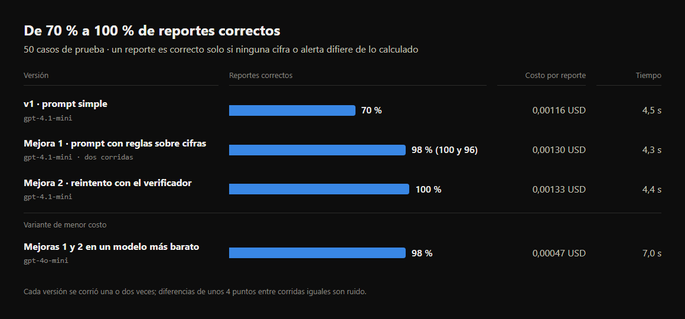
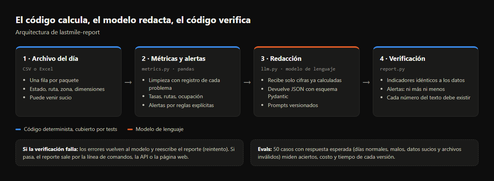
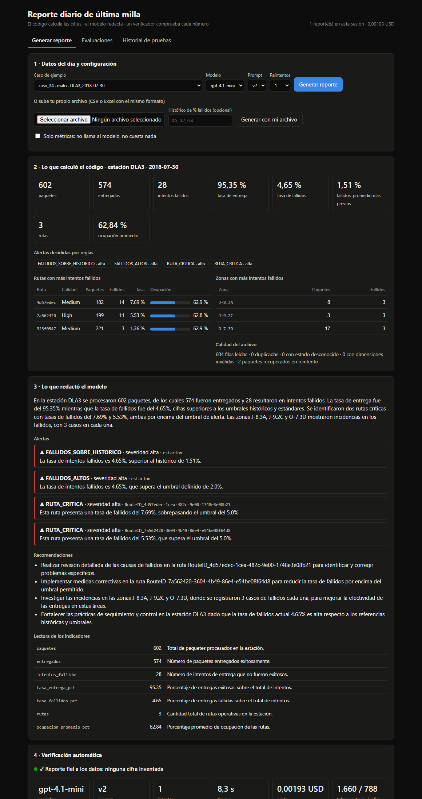
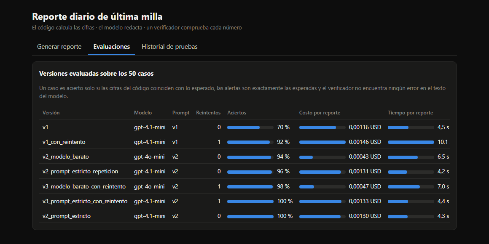

## 🚚 Reporte diario de última milla con IA generativa

Un asistente de **ingeniería de IA** que lee el archivo diario de una estación de entregas y redacta el reporte del día, con resumen, indicadores, alertas y recomendaciones.

La lección central del proyecto cabe en una frase: **el código calcula, el modelo redacta y un verificador comprueba cada número**.

🔗 **Repositorio:** [github.com/MiguelData2030/lastmile-report](https://github.com/MiguelData2030/lastmile-report)

---

## 🎯 El problema de negocio

En una operación logística, el reporte diario de entregas, intentos fallidos y cumplimiento se arma a mano desde Excel o desde el sistema. Es un trabajo repetitivo que consume tiempo todos los días.

Un modelo de lenguaje puede redactar ese reporte en segundos, pero tiene un problema serio para un reporte operativo: **no es confiable haciendo cuentas**. En mis pruebas, cuando lo dejé libre:

- Redondeó cifras ("tasa de entrega superior al 99 %" cuando el dato era 99,25 %).
- Inventó metas ("mantener la ocupación cercana al 60-70 %").
- Hizo cálculos por su cuenta ("3.08 puntos superior al histórico").

Un jefe de operación no puede tomar decisiones con cifras que nadie calculó.

---

## 💡 La solución: separar lo que calcula el código de lo que redacta el modelo

| Quién | Qué hace |
|---|---|
| **Código (pandas)** | Limpia el archivo, calcula las métricas y decide las alertas con reglas explícitas |
| **Modelo de lenguaje** | Recibe solo cifras ya calculadas y redacta el reporte en un JSON con esquema validado |
| **Verificador (código)** | Revisa que cada número del reporte exista en las métricas; si no, devuelve los errores al modelo para que corrija |

El modelo nunca ve las filas del archivo ni hace una suma.

---

## 🧰 Stack

- **Python 3.12 + uv** para el proyecto y las dependencias
- **pandas** para la limpieza y las métricas
- **Pydantic** para el esquema del reporte
- **SDK de OpenAI** con salida estructurada
- **FastAPI** para la API y la página web local
- **pytest + ruff** para tests y estilo
- **GitHub Actions** para integración continua

---

## 📦 Los datos

Usé el dataset público del **Amazon Last Mile Routing Research Challenge 2021**: 6.112 rutas y 1.457.175 paquetes de 17 estaciones en Estados Unidos, entre julio y agosto de 2018. Son datos anonimizados, sin nombres de clientes ni direcciones, con licencia CC BY-NC 4.0.

Lo convertí en 521 "archivos del día", uno por estación y fecha, que es lo que un analista descargaría al cierre de la jornada.

**Un hallazgo de los datos reales:** la versión inicial trataba como duplicado a todo paquete que aparecía dos veces en el día. Al revisar, eran paquetes con un intento fallido en una parada y la entrega en otra: reintentos exitosos, no errores. Corregirlo bajó la tasa mediana de fallidos de 0,58 % a 0,52 %. Los tests hechos a mano no bastan; hay que correr el código contra datos reales.

---

## 🧪 Cómo medí la calidad: 50 casos de prueba

Un sistema con un modelo dentro no se evalúa leyendo reportes a ojo. Construí un conjunto de **50 casos**, cada uno con su archivo de entrada y lo que el reporte debe decir:

- **20 días normales**, sin alertas graves
- **15 días malos**, con fallidos altos o rutas críticas
- **13 con datos sucios** inyectados a propósito: encabezados descuidados, estados mal escritos, coma decimal, filas duplicadas, estados desconocidos, dimensiones basura y formato Excel
- **2 archivos inválidos**, que el sistema debe rechazar con un mensaje claro

La respuesta esperada de cada caso se calcula con una implementación independiente, sin usar el código del proyecto. Un caso cuenta como acierto solo si las cifras, las alertas y el texto del modelo son correctos a la vez.

---

## 📊 Resultados: antes y después de dos mejoras

| Versión | Modelo | Aciertos | Costo por reporte | Tiempo por reporte |
|---|---|---|---|---|
| v1 · prompt simple | gpt-4.1-mini | 70 % | 0,00116 USD | 4,5 s |
| Mejora 1 · prompt con reglas sobre cifras | gpt-4.1-mini | 100 % y 96 % (dos corridas) | 0,00130 USD | 4,3 s |
| Mejora 2 · reintento con el verificador | gpt-4.1-mini | 100 % | 0,00133 USD | 4,4 s |
| Mejoras 1 y 2 en un modelo más barato | gpt-4o-mini | 98 % | 0,00047 USD | 7,0 s |

Lo que aprendí de estos números:

- **El código nunca falló.** Calculó bien el 100 % de los casos en todas las versiones; todos los errores vinieron del texto del modelo.
- **Mejora 1:** leí los 15 fallos de la versión inicial, los clasifiqué y escribí un prompt que prohíbe redondear, calcular y proponer umbrales propios.
- **Mejora 2:** si el verificador encuentra errores, se los devuelve al modelo para que reescriba el reporte. Con el prompt nuevo casi nunca se activa, así que funciona como red de seguridad barata.
- **Un modelo más barato llega a 98 %** con las dos mejoras, a un tercio del costo.

Y lo que estos números no dicen:

- Dos corridas idénticas dieron 100 % y 96 %, así que diferencias pequeñas son ruido.
- El prompt mejorado se escribió viendo los fallos de estos mismos 50 casos; falta validarlo en días nuevos.
- El verificador mide que las cifras sean fieles, no que el reporte sea útil. Eso lo dirá quien lo use en la operación.

---

## 🖥️ La aplicación

Una página web que corre en el propio equipo. Permite elegir un caso o subir un archivo, cambiar de modelo y de prompt, y ver en cuatro pasos qué calculó el código, qué redactó el modelo y si pasó la verificación, con su costo y su tiempo.

La pestaña de evaluaciones muestra todas las versiones medidas:

---

## 🧠 Lo que me llevo

1. **Un LLM en producción es un componente más**, y se le pone el mismo rigor que al resto: contrato de entrada, contrato de salida y pruebas.
2. **Sin un número de calidad no hay mejora**, solo opiniones. Los evals convierten "creo que quedó mejor" en "pasó de 70 % a 100 %".
3. **Los fallos del modelo se leen uno por uno.** Las dos mejoras salieron de clasificar errores reales, no de adivinar.
4. **Más caro no significa mejor.** Hay que medir cada modelo en la tarea propia.

Construí el proyecto trabajando en pareja con un asistente de IA (Claude Code): yo definí el problema, tomé las decisiones y juzgué los resultados, y el asistente escribió y explicó el código paso a paso.

---

## 🗺️ Próximos pasos

- Validarlo con una persona de operación que lo use cada semana.
- Probar el prompt en días fuera de los 50 casos.
- Agregar agentes que comparen contra el histórico y un tablero por estación.

🔗 **Código, casos de prueba y resultados completos:** [github.com/MiguelData2030/lastmile-report](https://github.com/MiguelData2030/lastmile-report)
