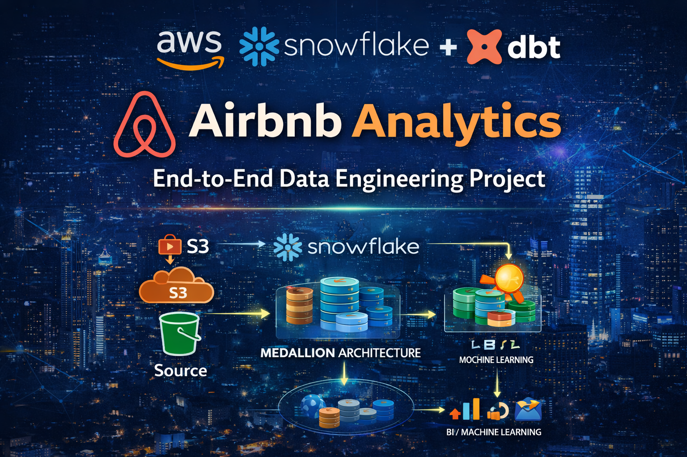
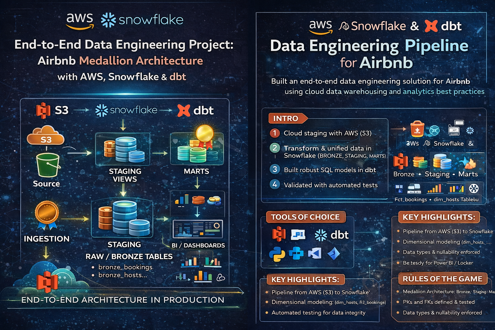
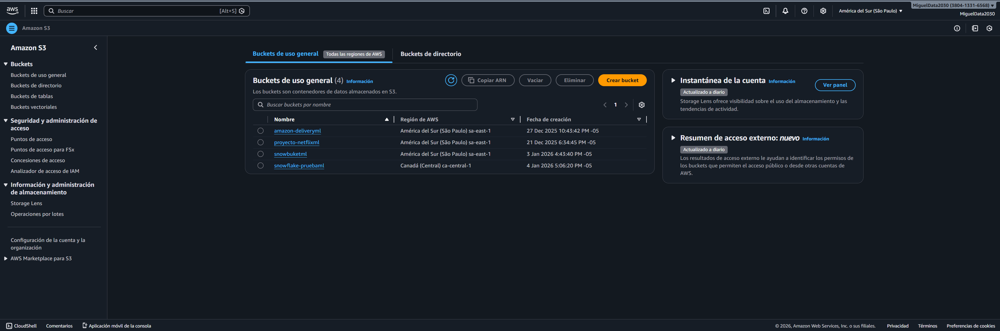
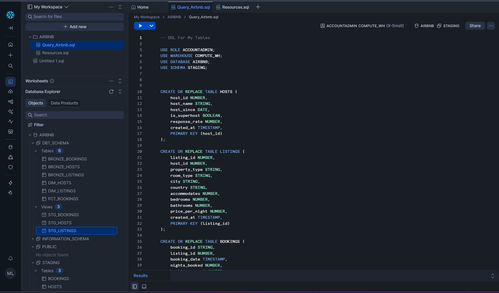
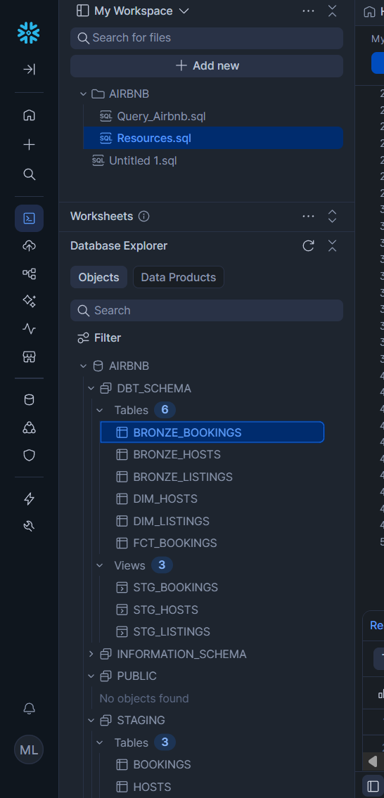
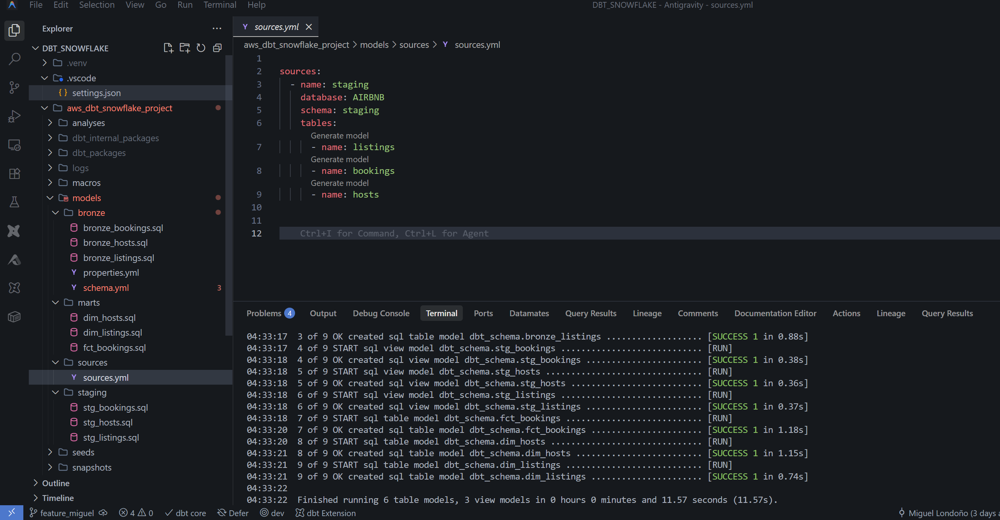
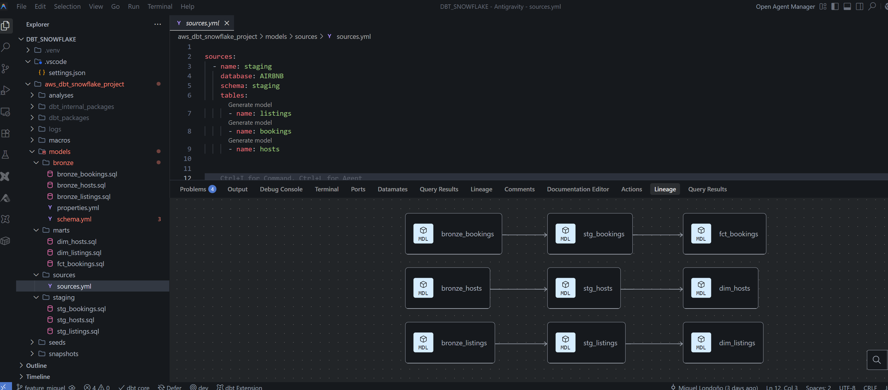

## 🏨 End-to-End Data Engineering Project – Airbnb (Reservas) 
Antes de escribir una sola línea de código, el primer paso fue **entender el negocio de Airbnb desde la perspectiva de datos**.

Airbnb opera a escala global, con millones de **listings**, **hosts** y **reservas**, lo que genera **volúmenes masivos de datos históricos y transaccionales**.  
Para este escenario, estimé un crecimiento aproximado de **~5 TB de datos**, considerando:

- Historial de reservas (bookings)
- Información de hosts
- Detalle de propiedades (listings)
- Cambios históricos y datos incrementales

El reto no era solo almacenar datos, sino **transformarlos en información confiable, escalable y reutilizable** para analítica y machine learning.

---

## 🎯 Problema de negocio

En un contexto como Airbnb, los equipos suelen enfrentarse a problemas como:

- Datos provenientes de **múltiples fuentes** (CSV, SQL, APIs)
- Inconsistencias en fechas, IDs y relaciones entre entidades
- Dificultad para escalar consultas analíticas sobre grandes volúmenes
- Falta de un **modelo de datos claro** para analistas y científicos de datos
- Dependencia excesiva de tablas crudas sin reglas de negocio definidas

👉 **Objetivo del proyecto**  
Diseñar un **pipeline end-to-end de Data Engineering** que permita transformar datos crudos de Airbnb en **datasets analíticos confiables**, listos para consumo en **Power BI** o por equipos de **Machine Learning**.

---

## 🏗️ Arquitectura utilizada

La solución se diseñó bajo una arquitectura **Lakehouse + Analytics Engineering**, separando claramente almacenamiento, procesamiento y consumo.

### Arquitectura general

- **Amazon S3** → Data Lake / Source of Truth  
- **Snowflake** → Motor analítico y Data Warehouse  
- **dbt** → Transformaciones, reglas de negocio y modelado analítico  
- **Antigravity** → Estructuración y estandarización del proyecto dbt  

Esta arquitectura permite:
- Escalar a grandes volúmenes de datos
- Separar cómputo y almacenamiento
- Mantener trazabilidad y control de calidad

---

## 🧰 Stack tecnológico

- **Amazon S3** → Almacenamiento de datos crudos (Lakehouse)
- **Snowflake** → Data Warehouse analítico
- **dbt (Data Build Tool)** → Transformaciones y modelado
- **Antigravity** → Organización del proyecto dbt
- **SQL** → Transformaciones y lógica de negocio
- **Git / GitHub** → Versionamiento y documentación
- **Power BI / ML-ready datasets** → Capa de consumo

---

## 🔄 Flujo de datos end-to-end

1. **Ingesta de datos**
   - Los datos crudos de Airbnb (CSV) se almacenan en **Amazon S3**
   - S3 actúa como la **fuente única de la verdad**

2. **Carga en Snowflake**
   - Snowflake consume los datos desde S3
   - Se almacenan inicialmente sin transformaciones complejas

3. **Transformaciones con dbt**
   - dbt se conecta directamente a Snowflake
   - Todas las reglas de negocio se versionan como código

4. **Capas analíticas**
   - Se construyen capas progresivas (Bronze → Staging → Marts)

5. **Consumo**
   - Los datos quedan listos para:
     - Dashboards en Power BI
     - Modelos de Machine Learning
     - Análisis exploratorio avanzado

---

## 🧱 Capas de datos en Snowflake

### 🟤 Bronze (Raw Layer)
- Datos casi sin transformación
- Tipificación básica
- Conserva la estructura original
- Garantiza trazabilidad hacia el origen

Ejemplos:
- `bronze_bookings`
- `bronze_hosts`
- `bronze_listings`

---

### 🔵 Staging (Clean Layer)
- Limpieza y estandarización
- Normalización de nombres
- Conversión de tipos de datos
- Preparación para reglas de negocio

Ejemplos:
- `stg_bookings`
- `stg_hosts`
- `stg_listings`

---

### 🟡 Marts (Business Layer)
Modelo analítico orientado al negocio:

#### Dimensiones
- `dim_hosts`
- `dim_listings`

#### Hechos
- `fct_bookings`

Diseñado bajo **Star Schema**, optimizado para:
- Consultas rápidas
- BI
- Machine Learning

---

## 📐 Reglas de negocio implementadas con dbt

Algunas reglas clave:

- Validación de claves primarias y foráneas
- Normalización de fechas de reserva
- Relación clara entre bookings, hosts y listings
- Definición de métricas reutilizables
- Tests automáticos (`not null`, `unique`, `relationships`)

Todo esto queda:
- Versionado
- Documentado
- Reproducible

---

## 📊 Escalabilidad de la solución

Esta arquitectura está preparada para crecer:

- **S3** escala prácticamente sin límite
- **Snowflake** separa almacenamiento y cómputo
- **dbt** permite mantener reglas de negocio incluso con miles de modelos
- Posibilidad de:
  - Incremental models
  - Particionamiento
  - Optimización por clusters

Funciona igual para **GBs o TBs de datos**.

---

## ✅ Conclusiones

- Se construyó un pipeline **end-to-end realista**, alineado a escenarios de Airbnb
- La separación por capas mejora la calidad, gobernanza y escalabilidad
- dbt demostró ser clave para **Analytics Engineering**
- El modelo final permite consumo inmediato por BI y ML

---

## 🔍 Reflexión final

Este proyecto demuestra que **Data Engineering no es solo mover datos**, sino:

- Entender el negocio
- Diseñar arquitecturas escalables
- Modelar datos pensando en quién los consume
- Tratar las reglas de negocio como código

Esta misma arquitectura puede adaptarse fácilmente a otros dominios como:
- E-commerce
- Logística
- Fintech
- Supply Chain

---

🚀 **End-to-End Data Engineering Project – Airbnb**
